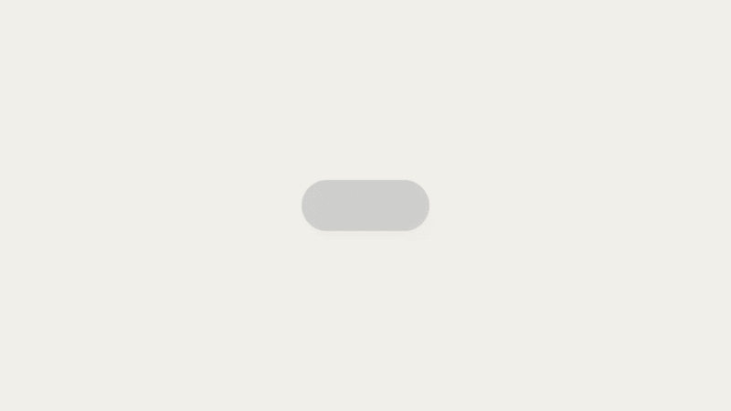

# motion-graphics

Motion-graphics skills for Claude Code. Each skill does one job.

| Skill | What it does |
|---|---|
| `motion-broll` | Give it a video and a transcript and it makes motion-graphic B-roll timed to your words. |
| `motion-reel` | Give it a brief, your brand and a music track and it makes a short launch, data or kinetic-type reel cut on the beat. |

More skills will be added to this repo.

## motion-broll

**Motion-graphic B-roll for your videos, made by Claude Code.** Give it a video and a transcript and it plans, animates and renders clips timed to your words. Each clip is one continuous shape that keeps morphing (pill → card → terminal → chart) and never cuts, with a cursor driving every change.

<p>
  
  
</p>

## What you get

You run `/motion-broll`, answer a few questions, approve a plan, and get back:

- **The clips**, named by where they go on your timeline (`04-master-prompt_0m32s40.mp4`). Full-frame cutaways are MP4. Panels that sit in empty space next to you are transparent ProRes 4444 `.mov`.
- **A preview render** of your video with the clips cut in.
- **`compare.html`**: original vs. with motion graphics, synced, as side by side, stacked or wipe.
- **`viewer.html`**: step through the clips one by one.
- **`TIMING.md`**: every clip with its in/out point and the line it covers.

The preview is for review. For your final cut, drop the clips into your own editor.

## Install

```
npx skills add Barty-Bart/motion-graphics
```

That installs the skills from this repo (pick `motion-broll`, `motion-reel` or both). It works in Claude Code and other agents that read skills.

Or copy `skills/motion-broll` (or `skills/motion-reel`) into your project's `.claude/skills/` (or `~/.claude/skills/` to use it everywhere).

**Requirements:** Node 18+, Python 3, and ffmpeg (with the ProRes encoder, standard in Homebrew builds). On first run the skill installs Playwright and Chromium into a local `motion/` folder.

## Use it

```
/motion-broll
```

Then point it at your video and transcript (an SRT from your editor, Descript or YouTube works). It will:

1. **Inspect the footage.** It reads resolution, frame rate and layout, including picture-in-picture sections and whether the box changes size.
2. **Estimate word timings** from your transcript.
3. **Plan the clips** in a table and wait for your OK. For each clip it chooses a full-frame cutaway, a transparent panel in empty space, or nothing, and tells you why.
4. **Build each clip**, check stills on the key words, and fix what's off.
5. **Render** with motion blur at your video's frame rate, then make the preview and the comparison pages.

It never invents numbers or results. Bars show relative size and text uses skeleton lines until you give it the real figures.

## motion-reel

**A short motion-graphics video from a brief, with no footage needed.** Use it for a product launch, a feature drop, a data story, kinetic type, an explainer or a showreel. It locks your brand to 3 colours and 2 fonts, finds the beat in your music, cuts every scene on it, and ends on your call to action.

<p></p>

Run `/motion-reel` and it will:

1. **Write the brief with you**: the one message, the CTA, your 3 colours and 2 fonts, the track, and the only facts it may show as numbers.
2. **Find the beat**: tempo, beats and downbeats from your track (or a bpm you give it).
3. **Plan in beats** from a library of recipes (product launch, data and charts, kinetic type, explainer, showreel), fitted to your brand, your real product and your track. It waits for your OK.
4. **Build and check**: one scene per file, timed with a beat clock, checked by a brand linter that rejects off-brand colours, fonts, gradients and glows, then checked as stills on the beats.
5. **Render and assemble**: each scene with motion blur at 60 fps, hard-cut on the beat, with your music trimmed to start on the right downbeat and faded out.

You get `reel.mp4`, each scene as its own MP4, and `review.html` for checking frame by frame (step frames, jump scenes, loop a scene, quarter speed, distance to the nearest beat). Change the track or the bpm and every scene re-times itself.

The worked example in `skills/motion-reel/examples/launch-reel/` is the reel above, for a made-up product.

## How it works

- Every frame is a pure function of time. Springs are closed-form step responses, and a value that changes target many times is the sum of one spring per change. There are no CSS transitions or timers, so any frame can be rendered on its own.
- Clips are small HTML files on a shared engine (`engine/motion.js`, the same in both skills). Headless Chromium captures 4 sub-frames per frame across a 180° shutter, and ffmpeg blends them into motion blur.
- The worked example in `skills/motion-broll/examples/opus-aoe2/` is the six clips from the motion-broll demo.
- In `motion-reel`, scenes are timed in beats. `build.py` turns beats into frame-exact cut points, so the scenes join with no drift and every cut stays on the beat.

## Licence

MIT. Geist fonts: SIL Open Font License. Icon paths adapted from Lucide (ISC).
